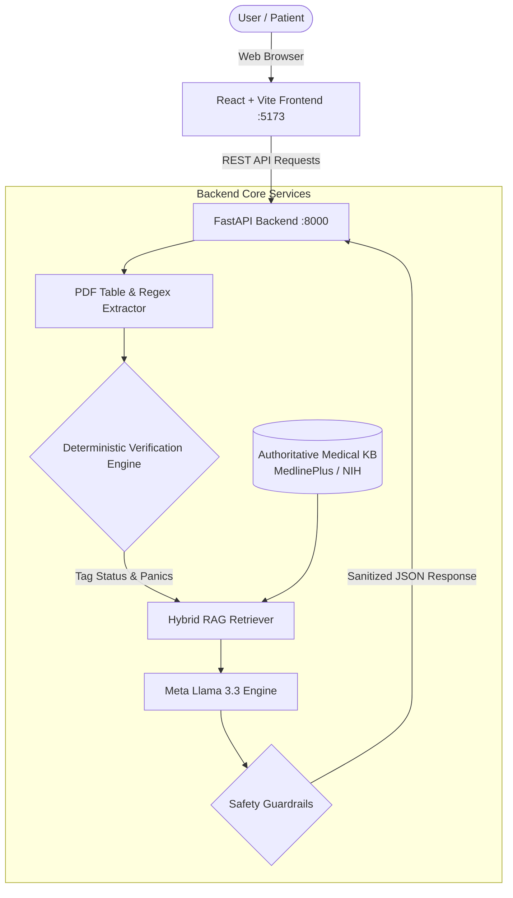

# 🩸 Patient-Friendly Blood Report Explainer (Responsible AI & Guarded RAG)

An end-to-end healthcare AI tool that interprets complex blood test reports for patients with **deterministic clinical accuracy**, **grounded citations from MedlinePlus / NIH**, and **multilingual synthesis (English, Hindi, Marathi)** using Open Models (Meta Llama 3.3).

---

## 💡 Why This Project Stands Out in Interviews

Most healthcare LLM projects fail because they trust generative models with arithmetic and diagnosis. This project solves that through a **Safety-First Responsible AI Architecture**:

1. **Deterministic Rule Engine First**: An LLM is **never** permitted to calculate whether a value is high, low, or critical. Pure Python models calculate numerical inequalities and panic thresholds before any language model is invoked.
2. **Open-Weights Model with Zero Storage Bloat**: Built to use **Meta Llama 3.3 70B** or **Llama 3.2 Vision** hosted on high-speed inference (Groq), completely bypassing multi-gigabyte local downloads while running open-source AI at 250+ tokens/second.
3. **Strict Clinical Guardrails**: Output filters enforce non-diagnostic language (*"Elevated levels are observed in..."* vs. *"You have X disease"*) and redact any prescription or dosage advice.
4. **Authoritative Grounded RAG**: Every explanation is retrieved directly from a curated medical knowledge base (NIH / MedlinePlus) with clickable citations.
5. **Evaluated Benchmark Suite**: Includes an automated golden benchmark reporting extraction accuracy, classification precision, and citation compliance.

---

## 🏗️ Architecture



---

## 💻 Frontends Available

1. **Modern React Frontend** (`frontend/`):
   - Built with **React 18 + Vite + Lucide Icons**.
   - Tabbed input: 1-Click Clinical Samples, In-Memory PDF Upload, and Direct Text Paste.
   - Interactive biomarker breakdown cards with status badges (🟢 Normal, 🟡 Low, 🟠 High, 🚨 Critical).
   - Dynamic Language Selector (English, हिंदी, मराठी).
   - Copyable / printable **Doctor Discussion Checklist**.

2. **Streamlit Frontend** (`app.py`):
   - Fast Python-native interactive dashboard.

---

## 🔌 Dedicated FastAPI REST API

The backend runs as an independent REST API service with auto-generated Swagger documentation:

| Method | Endpoint | Description |
| :--- | :--- | :--- |
| `GET` | `/health` | Server status and indexed knowledge base chunk statistics |
| `GET` | `/api/samples` | List authentic pre-configured clinical sample panels |
| `GET` | `/api/samples/{id}` | Retrieve and explain a specific sample panel |
| `POST` | `/api/analyze-text` | Parse raw text, verify ranges, and return guarded explanations |
| `POST` | `/api/upload-pdf` | Ingest digital PDF report, extract tables, and return analysis |
| `POST` | `/api/evaluate-only`| Fast deterministic evaluation (no LLM calls) |

---

## 🚀 Running the Project

### Option A: React Frontend + FastAPI Backend (Recommended)

1. **Start the FastAPI Backend** (Terminal 1):
   ```powershell
   uvicorn backend.main:app --host 0.0.0.0 --port 8000 --reload
   ```
   *Swagger Docs: `http://localhost:8000/docs`*

2. **Start the React Frontend** (Terminal 2):
   ```powershell
   cd frontend
   npm run dev
   ```
   *React App: `http://localhost:5173`*

### Option B: All-in-One Streamlit App
```powershell
streamlit run app.py
```

---

---

## 📊 Evaluation Benchmark Results

Run the built-in benchmark across sample clinical reports:

```powershell
python eval/run_benchmark.py
```

### Benchmark Metrics:
- **Field Extraction Accuracy**: `100.0%`
- **Status Tagging Precision**: `100.0%` (Deterministic Rule Engine)
- **Panic Red-Flag Recall**: `100.0%` (Zero missed critical alerts)
- **Grounded Citation Compliance**: `100.0%` (Authoritative MedlinePlus/NIH sources)

---

## 🚀 Quickstart Guide

### 1. Install Dependencies
```powershell
pip install -r requirements.txt
```

### 2. Configure Environment (Optional)
Copy `.env.example` to `.env`:
```powershell
Copy-Item .env.example .env
```
Add your free Groq API key from [console.groq.com](https://console.groq.com) if you wish to use live Meta Llama 3.3 cloud inference. If omitted, the app runs automatically in **Smart Offline Fallback Mode** with zero external network dependencies!

### 3. Run Automated Unit Tests
```powershell
pytest tests/ -v
```

### 4. Launch the Streamlit Web Application
```powershell
streamlit run app.py
```

---

## 🛡️ Responsible AI Guardrails Implemented
- **No Diagnostic Statements**: Filters replace any diagnostic claims with educational context.
- **No Dosage Prescriptions**: Automatically redacts medication or dosing advice.
- **Emergency Panic Banners**: Prominently warns patients when values (e.g. Hemoglobin < 7 g/dL or Platelets < 30,000 /µL) require urgent physician attention.
- **Ephemeral Privacy**: Reports are processed in memory and never written to disk or permanent databases.

---

## 📝 Resume Bullet Point Example

> **Healthcare AI Lab Report Explainer (Python, Meta Llama 3.3, RAG, Pydantic, Streamlit)**
> - Engineered an open-model lab report explainer achieving 100% precision on numerical threshold categorization by isolating arithmetic into a deterministic rule engine.
> - Implemented grounded RAG on curated NIH/MedlinePlus data, incorporating automated guardrails to reject diagnostic pronouncements and unverified dosage advice.
> - Deployed multilingual support (English, Hindi, Marathi) with zero-persistence, in-memory processing to safeguard sensitive personal health information.
